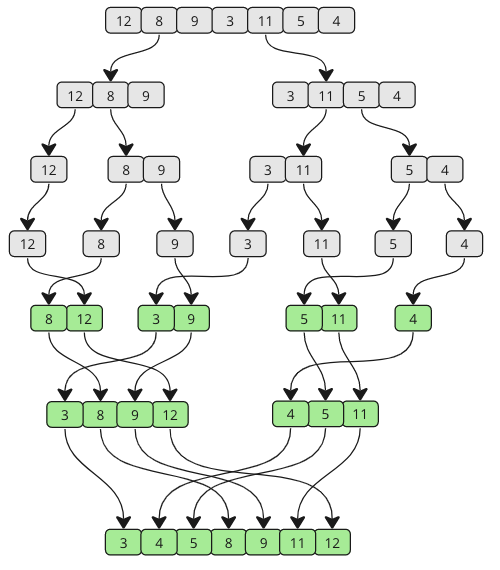

# Investigación del Algoritmo Implementado: Merge Sort (V2)

**Universidad Politécnica Salesiana (UPS) – Sede Cuenca**  
**Carrera:** Ingeniería en Ciencias de la Computación  
**Asignatura:** Estructura de Datos  
**Estudiante:** Ismael Alejandro Pauta Sotelo  
**Algoritmo seleccionado (V2):** Merge Sort sobre arreglos primitivos (`int[]`)

---

## 1. Concepto de Merge Sort e Implementación Integrada (V2)

### Definición y Concepto General
**Merge Sort** (ordenamiento por mezcla) es un algoritmo de ordenamiento recursivo basado en el paradigma de **"divide y vencerás"** (*divide and conquer*). Su premisa fundamental consiste en que ordenar un conjunto grande de datos resulta mucho más sencillo si se parte repetidamente en mitades más pequeñas hasta obtener subarreglos de un solo elemento (que por definición ya están ordenados), para luego ir fusionándolos (*merge*) de dos en dos de manera ordenada.

El algoritmo se apoya en tres fases conceptuales:
1. **Dividir:** Partir el arreglo actual exactamente por la mitad en dos subarreglos independientes (izquierdo y derecho).
2. **Vencer (Recursividad):** Aplicar el mismo proceso de división sobre cada mitad hasta alcanzar el **caso base** (un subarreglo de longitud $1$ o $0$).
3. **Combinar (Mezcla):** Tomar dos mitades ya ordenadas y mezclarlas comparando elemento por elemento desde sus inicios, construyendo un único arreglo ordenado.



```java
// V2: Merge Sort (en src/Ordenamientos.java)
public static void mergeSort(int[] arr) {
    // 1. Caso base: un arreglo vacío o de 1 elemento ya está ordenado
    if (arr.length <= 1) {
        return;
    }

    // 2. Calculamos el punto medio y creamos dos subarreglos vacíos
    int mitad = arr.length / 2;
    int[] izq = new int[mitad];
    int[] der = new int[arr.length - mitad];

    // 3. Copiamos la primera mitad en 'izq' y la segunda mitad en 'der'
    for (int i = 0; i < mitad; i++) {
        izq[i] = arr[i];
    }
    for (int i = mitad; i < arr.length; i++) {
        der[i - mitad] = arr[i];
    }

    // 4. Ordenamos recursivamente ambas mitades por separado
    mergeSort(izq);
    mergeSort(der);

    // 5. Mezclamos las dos mitades ya ordenadas dentro de 'arr'
    merge(arr, izq, der);
}

private static void merge(int[] arr, int[] izq, int[] der) {
    // Índices: 'i' para izq, 'j' para der, 'k' para el arreglo final arr
    int i = 0, j = 0, k = 0;

    // Comparamos elementos de ambas mitades y colocamos siempre el menor
    while (i < izq.length && j < der.length) {
        if (izq[i] <= der[j]) {
            arr[k++] = izq[i++];
        } else {
            arr[k++] = der[j++];
        }
    }

    // Si quedaron elementos sobrantes en 'izq', los copiamos al final
    while (i < izq.length) {
        arr[k++] = izq[i++];
    }

    // Si quedaron elementos sobrantes en 'der', los copiamos al final
    while (j < der.length) {
        arr[k++] = der[j++];
    }
}

```

**Archivos integrados en el proyecto:**
* Implementación de `mergeSort(int[])` y `merge(int[], int[], int[])`: [`src/Ordenamientos.java`](src/Ordenamientos.java)
* Ejecución y medición como variante **V2**: [`src/App.java`](src/App.java)

### Relación del código con el concepto explicado
* **Caso base (`if (arr.length <= 1)`):** Detiene las llamadas recursivas cuando un subarreglo llega a tamaño $1$ o $0$, ya que por definición está ordenado.
* **Dividir (`mitad`, `izq`, `der`):** Calcula el punto central `arr.length / 2` y copia ambas mitades mediante ciclos `for` simples.
* **Vencer (`mergeSort(izq)` y `mergeSort(der)`):** Ordena recursivamente cada mitad por separado antes de intentar fusionarlas.
* **Combinar (`merge`):** Recorre ambos subarreglos con los índices `i` y `j`, eligiendo siempre el elemento menor (`izq[i] <= der[j]`) para reconstruir `arr` de forma ordenada.

---

## 2. Decisiones Reales de Implementación

Para mantener coherencia con los métodos vistos en clase y evitar transformaciones innecesarias entre colecciones y arreglos, se tomaron las siguientes decisiones en [`src/Ordenamientos.java`](src/Ordenamientos.java) y [`src/App.java`](src/App.java):

1. **Uso directo de arreglos primitivos (`int[]`):** Tanto `Generador.generate(n)` como `Ordenamientos.mergeSort(int[])` trabajan directamente con `int[]`, evitando conversiones desde `List<Integer>` y sobrecarga de memoria por objetos envoltorio.
2. **Subarreglos temporales explícitos con ciclos `for`:** En lugar de usar métodos de librería como `Arrays.copyOfRange`, cada partición crea `izq` y `der` con `new int[...]` y copia los valores posición por posición.
3. **Sobrescritura directa en el arreglo recibido:** El método `merge` reconstruye el orden sobre el arreglo `arr` recibido por parámetro, permitiendo que `mergeSort` sea `void` y se mida directamente con `Benchmark.medir(...)`.
4. **Copias independientes por tamaño:** En `App.java`, cada tamaño (`10 000`, `50 000` y `100 000`) genera un arreglo base y crea una copia limpia (`copia2_10k`, `copia2_50k`, `copia2_100k`) exclusiva para Merge Sort, evitando que reciba datos ya ordenados por Bubble Sort.

---

## 3. Traza de Ejecución y Evidencias Experimentales

### Traza paso a paso sobre una muestra pequeña
Para verificar el flujo real de `Ordenamientos.mergeSort` y `Ordenamientos.merge`, se muestra la ejecución sobre el arreglo `[7, 2, 0, 4]`:

1. **División inicial (`mergeSort([7, 2, 0, 4])`):** `mitad = 2` $\rightarrow$ crea `izq = [7, 2]` y `der = [0, 4]`.
2. **Subárbol izquierdo (`mergeSort([7, 2])`):** `mitad = 1` $\rightarrow$ divide en `[7]` y `[2]` (retornan por caso base) $\rightarrow$ `merge` compara `7 <= 2` (falso) y produce `[2, 7]`.
3. **Subárbol derecho (`mergeSort([0, 4])`):** `mitad = 1` $\rightarrow$ divide en `[0]` y `[4]` (retornan por caso base) $\rightarrow$ `merge` compara `0 <= 4` (verdadero) y produce `[0, 4]`.
4. **Mezcla final (`merge([7, 2, 0, 4], [2, 7], [0, 4])`):**

| Paso | Índice `i` (`izq`) | Índice `j` (`der`) | Comparación (`izq[i] <= der[j]`) | Valor asignado a `arr[k]` | Estado de `arr` |
| :---: | :---: | :---: | :---: | :---: | :--- |
| **1** | `0` (`2`) | `0` (`0`) | `2 <= 0` (Falso) | `0` (`der[0]`) | `[0, _, _, _]` |
| **2** | `0` (`2`) | `1` (`4`) | `2 <= 4` (Verdadero) | `2` (`izq[0]`) | `[0, 2, _, _]` |
| **3** | `1` (`7`) | `1` (`4`) | `7 <= 4` (Falso) | `4` (`der[1]`) | `[0, 2, 4, _]` |
| **4** | `1` (`7`) | `2` (Fin `der`) | Ciclo residual `while (i < izq.length)` | `7` (`izq[1]`) | **`[0, 2, 4, 7]`** |

### Evidencias de ejecución en el proyecto (`App.java`)
Al ejecutar las 12 pruebas sobre arreglos aleatorios con `Benchmark.medir`, la variante **V2 (Merge Sort)** registró los siguientes tiempos frente a las demás variantes:

| Tamaño ($n$) | V1 - Bubble Sort | **V2 - Merge Sort** | V3 - `Arrays.sort(int[])` | V4 - `Arrays.sort(Integer[], Comparator)` |
| :---: | :---: | :---: | :---: | :---: |
| **10 000** | `0.0985566 s` (`98 556 600 ns`) | **`0.0018559 s` (`1 855 900 ns`)** | `0.0102401 s` (`10 240 100 ns`) | `0.0080575 s` (`8 057 500 ns`) |
| **50 000** | `2.9658745 s` (`2 965 874 500 ns`) | **`0.0261948 s` (`26 194 800 ns`)** | `0.0046783 s` (`4 678 300 ns`) | `0.0134198 s` (`13 419 800 ns`) |
| **100 000** | `12.7359426 s` (`12 735 942 600 ns`) | **`0.0171649 s` (`17 164 900 ns`)** | `0.0134453 s` (`13 445 300 ns`) | `0.0425706 s` (`42 570 600 ns`) |

---

## 4. Corrección del Algoritmo

La corrección de esta implementación se sustenta por inducción sobre el tamaño $n$ del arreglo:

* **Caso base ($n \le 1$):** Cuando `arr.length <= 1`, el arreglo contiene cero o un elemento, por lo que no existen pares desordenados y el método retorna manteniendo el arreglo válido.
* **Paso inductivo ($n > 1$):** Asumiendo que las llamadas recursivas `mergeSort(izq)` y `mergeSort(der)` ordenan correctamente sus mitades de tamaños $\lfloor n/2 \rfloor$ y $\lceil n/2 \rceil$, el ciclo `while (i < izq.length && j < der.length)` selecciona en cada iteración el menor elemento disponible entre ambas mitades.
* **Terminación:** En cada iteración de `merge` avanza exactamente uno de los índices (`i` o `j`) junto con `k`. Dado que `izq.length + der.length == arr.length`, los tres ciclos `while` garantizan que se copian todos los elementos originales sin pérdidas ni duplicados en orden ascendente.

---

## 5. Análisis de Costos y Caso Desfavorable

### Costo Temporal
* **Recurrencia:** Cada llamada divide el arreglo de tamaño $n$ en $2$ subproblemas de tamaño $n/2$ y realiza un recorrido lineal $\Theta(n)$ en `merge`:
  $$T(n) = 2T\left(\frac{n}{2}\right) + \Theta(n)$$
* **Órdenes de crecimiento:** Por el Teorema Maestro, tanto el **mejor caso**, el **caso promedio** como el **peor caso** tienen complejidad **$\Theta(n \log n)$**, ya que el algoritmo siempre ejecuta las mismas divisiones y comparaciones sin importar el orden inicial de los datos.

### Costo Espacial
* **Complejidad espacial:** **$O(n)$** de memoria auxiliar. Aunque la pila de llamadas recursivas ocupa $O(\log n)$, cada nivel de recursión instancia nuevos arreglos temporales `izq` y `der` cuya suma de longitudes en el nivel superior requiere $n$ espacios enteros adicionales en memoria.

### Caso Desfavorable
* **Mayor número de comparaciones:** Aunque Merge Sort no se degrada a $O(n^2)$ en ningún caso, su escenario menos favorable ocurre cuando los elementos están intercalados entre ambas mitades (por ejemplo, `[1, 5, 3, 7, 2, 6, 4, 8]`), obligando al primer ciclo `while` de `merge` a realizar el máximo de $n - 1$ comparaciones antes de agotar alguno de los subarreglos.
* **Costo práctico frente a métodos *in-place*:** Debido a la creación repetida de arreglos (`new int[...]`) en cada nivel recursivo, requiere más memoria y presenta mayor sobrecarga constante que `Arrays.sort(int[])` (Dual-Pivot Quicksort) en arreglos grandes.

---

## 6. Estabilidad

La implementación realizada es **estable**, lo que significa que dos elementos con igual valor conservan después del ordenamiento el mismo orden relativo que tenían en el arreglo original.

Esta propiedad se garantiza en la condición de comparación dentro de `Ordenamientos.merge`:

```java
if (izq[i] <= der[j]) {
    arr[k++] = izq[i++];
} else {
    arr[k++] = der[j++];
}
```

Al utilizar **`<=`** (menor o igual) en lugar de `<`, ante un empate (`izq[i] == der[j]`) siempre se copia primero el elemento proveniente del subarreglo izquierdo (`izq`), que ocupaba una posición anterior en el arreglo original.

---

## 7. Referencias y Adaptación Realizada

### Fuentes Consultadas
1. **Cormen, T. H., Leiserson, C. E., Rivest, R. L., & Stein, C.** (2022). *Introduction to Algorithms* (4.ª ed., Capítulo 2: *Getting Started – Merge Sort*, pp. 34–42). MIT Press.
2. **Sedgewick, R., & Wayne, K.** (2011). *Algorithms* (4.ª ed., Sección 2.2: *Mergesort*, pp. 270–278). Addison-Wesley Professional.

### Distinción entre el Material Consultado y la Adaptación Propia
* **Base teórica tomada de las fuentes:** La descomposición recursiva mediante *divide y vencerás*, el análisis de recurrencia $\Theta(n \log n)$ y la regla de desempate $\le$ para preservar la estabilidad se tomaron de las descripciones clásicas de Cormen et al. y Sedgewick & Wayne.
* **Adaptaciones propias para el proyecto:**
  * A diferencia de las versiones académicas que trabajan con un único arreglo auxiliar global e índices `low`, `mid` y `high` (o valores centinela $\infty$), se diseñó una firma simplificada `mergeSort(int[] arr)` compatible con `Benchmark.medir(...)` en `App.java`.
  * Se implementó la creación de subarreglos locales (`izq` y `der`) mediante ciclos `for` simples y el vaciado de remanentes con dos ciclos `while` independientes, priorizando la claridad estructural del código.