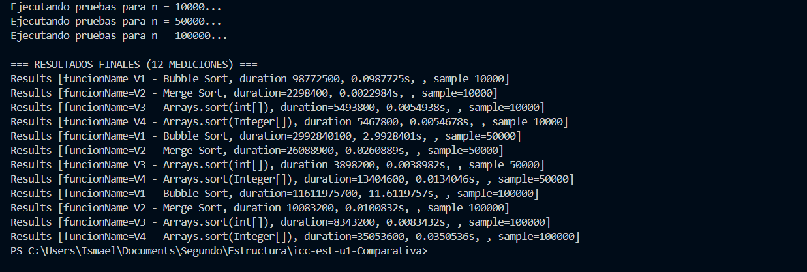

# Práctica de Laboratorio: Comparativa de Algoritmos de Ordenamiento

**Universidad Politécnica Salesiana (UPS) – Sede Cuenca**  
**Carrera:** Ingeniería en Ciencias de la Computación  
**Asignatura:** Estructura de Datos  
**Autor:** Ismael Alejandro Pauta Sotelo  

---

## 1. Objetivo y Métodos Seleccionados

Evaluar y comparar empíricamente el tiempo de ejecución de cuatro enfoques de ordenamiento en Java sobre arreglos de números enteros generados aleatoriamente en tres tamaños de muestra (**10 000**, **50 000** y **100 000** elementos)[cite: 7]:

1. **Método básico elegido — Bubble Sort (`Ordenamientos.bubbleSort`):** Algoritmo iterativo de intercambio adyacente sobre `int[]` ($O(n^2)$)[cite: 7, 8].
2. **Método investigado elegido — Merge Sort (`Ordenamientos.mergeSort`):** Algoritmo recursivo de *divide y vencerás* sobre `int[]` ($O(n \log n)$)[cite: 7, 8]. Su análisis teórico y traza detallada se encuentran en [`INVESTIGACION.md`](INVESTIGACION.md).
3. **Variante nativa primitiva — `Arrays.sort(int[])` (`Ordenamientos.sortPrimitivo`):** Implementación estándar del JDK basada en *Dual-Pivot Quicksort*[cite: 7, 8].
4. **Variante nativa con comparador — `Arrays.sort(Integer[], Comparator)` (`Ordenamientos.sortComparator`):** Implementación estándar del JDK sobre envoltorios `Integer[]` con comparador `(a, b) -> a - b`, basada en *TimSort*[cite: 7, 8].

---

## 2. Entorno, Organización y Ejecución

### Entorno de Desarrollo
* **Lenguaje:** Java (JDK)[cite: 7]
* **Editor / IDE:** Visual Studio Code
* **Sistema Operativo:** Windows / Linux (ejecución directa desde terminal)[cite: 1]

### Organización de Paquetes y Responsabilidades de las Clases
El proyecto trabaja directamente en el paquete por defecto dentro de `src/` bajo la siguiente estructura[cite: 6, 7]:

    ├── evidencias/
    │   ├── pruebas.md             # Documentación de casos de aceptación y salidas reales
    │   └── consola-resultados.png # Captura legible de la lista completa impresa en consola
    ├── investigacion/
    │   └── mergesort.png          # Diagrama gráfico de funcionamiento de Merge Sort
    ├── src/
    │   ├── App.java               # Orquesta las 12 ejecuciones, clona arreglos e imprime resultados
    │   ├── Generador.java       # Genera arreglos int[] aleatorios según el tamaño solicitado
    │   ├── Ordenamientos.java     # Contiene las 4 implementaciones de ordenamiento evaluadas
    │   ├── Benchmark.java         # Encapsula la medición de tiempo con System.nanoTime()
    │   └── Results.java           # Modelo para almacenar variante, tiempo registrado y tamaño de muestra
    ├── INVESTIGACION.md           # Investigación formal del algoritmo Merge Sort (V2)
    └── README.md                  # Documentación general, metodología, resultados y conclusiones

* **`Generador`:** Produce un único arreglo `int[]` con valores enteros aleatorios por cada tamaño (`n`)[cite: 7].
* **`Ordenamientos`:** Implementa los métodos estáticos `bubbleSort`, `mergeSort`, `sortPrimitivo` y `sortComparator`[cite: 7].
* **`Benchmark`:** Ejecuta una tarea recibida como expresión lambda y calcula su duración exacta[cite: 7].
* **`Results`:** Almacena el identificador de la variante, el tiempo en nanosegundos, su conversión a segundos y el tamaño de muestra (`sample`)[cite: 1, 7].
* **`App`:** Ejecuta las pruebas en orden, crea copias independientes fuera del cronómetro, guarda los resultados en una `List<Results>` y los imprime al finalizar[cite: 7].

### Comandos Reales de Compilación y Ejecución
Desde la raíz del proyecto[cite: 7]:

    javac -d bin src/*.java
    java -cp bin App

---

## 3. Explicación del Benchmarking (`Benchmark.java` y `App.java`)

Para medir cada algoritmo con precisión y sin contaminar los tiempos, la arquitectura de medición sigue estas reglas[cite: 7]:

* **Interfaz funcional y envío mediante lambdas:** El método `Benchmark.medir(Runnable tarea, String nombre, int sample)` recibe el bloque de código a evaluar a través de la interfaz funcional `Runnable` de Java, invocada desde `App.java` mediante expresiones lambda (por ejemplo: `() -> Ordenamientos.mergeSort(copia2_10k)`), lo que permite cronometrar cualquier método de ordenamiento con una única firma genérica[cite: 7].
* **Inicio y fin del cronómetro:** Dentro de `Benchmark.medir`, se captura el instante inicial mediante `long inicio = System.nanoTime();`, inmediatamente después se ejecuta `tarea.run();` y al retornar se registra `long fin = System.nanoTime();`[cite: 7].
* **Unidades y significado de `sample`:** La diferencia `fin - inicio` obtiene la duración en **nanosegundos (`ns`)**[cite: 7]. En `Results.toString()` este valor se conserva en nanosegundos y se convierte también a **segundos (`duration / 1_000_000_000.0`)**[cite: 1, 7]. El atributo **`sample`** representa el tamaño $n$ del arreglo ordenado en esa corrida (`10000`, `50000` o `100000`)[cite: 1, 7].
* **Operaciones excluidas del cronómetro:** La generación de números aleatorios (`Generador.generate`), la clonación de arreglos (`Arrays.copyOf`) y la conversión de `int[]` a `Integer[]` para la variante V4 se realizan **antes** de llamar a `Benchmark.medir`, asegurando que solo se cronometre el algoritmo de ordenamiento[cite: 7].
* **Tratamiento de errores:** El flujo garantiza arreglos no nulos y tamaños positivos definidos en `App.java`; en caso de recibir un arreglo de longitud $\le 1$, los métodos de ordenamiento retornan de forma controlada sin lanzar excepciones (`ArrayIndexOutOfBoundsException` o `NullPointerException`)[cite: 7].
* **Almacenamiento e impresión final:** Cada llamada a `Benchmark.medir` retorna un objeto `Results` que se agrega secuencialmente a una `List<Results> resultados = new ArrayList<>()`. Una vez completadas las 12 corridas, un ciclo `for-each` recorre la lista e imprime en consola todas las mediciones juntas para evitar que las operaciones de entrada/salida (`System.out.println`) interfieran entre pruebas[cite: 7].

---

## 4. Procedimiento Experimental y Resultados

### Procedimiento
1. Se evaluaron tres tamaños de entrada en orden creciente: **`10 000`**, **`50 000`** y **`100 000`**[cite: 1, 7].
2. Para cada tamaño se generó **una única muestra aleatoria base** y se extrajeron **cuatro copias independientes** (`copia1` a `copia4`) fuera del cronómetro, garantizando que los cuatro algoritmos ordenaran exactamente los mismos datos desordenados[cite: 7].
3. En cada tamaño se ejecutaron en secuencia: **V1 (Bubble Sort)** $\rightarrow$ **V2 (Merge Sort)** $\rightarrow$ **V3 (`Arrays.sort(int[])`)** $\rightarrow$ **V4 (`Arrays.sort(Integer[], Comparator)`)**[cite: 1, 7].

### Captura de Salida en Consola

*(Documentación adicional de casos de aceptación en [`evidencias/EVIDENCIAS.md`](evidencias/EVIDENCIAS.md)).*[cite: 7]

### Tabla de Resultados (12 Mediciones)

Los siguientes valores corresponden exactamente a los tiempos obtenidos en la ejecución real mostrada en la captura de consola[cite: 1, 8, 9]:

| Método | Sample | Tiempo (`s` / `ns`) |
| :--- | :---: | :---: |
| **V1 - Bubble Sort** | 10 000 | `0.0985566 s` (`98 556 600 ns`)[cite: 1] |
| **V2 - Merge Sort** | 10 000 | `0.0018559 s` (`1 855 900 ns`)[cite: 1] |
| **Arrays.sort · int[]** | 10 000 | `0.0102401 s` (`10 240 100 ns`)[cite: 1] |
| **Arrays.sort + Comparator · Integer[]** | 10 000 | `0.0080575 s` (`8 057 500 ns`)[cite: 1] |
| **V1 - Bubble Sort** | 50 000 | `2.9658745 s` (`2 965 874 500 ns`)[cite: 1] |
| **V2 - Merge Sort** | 50 000 | `0.0261948 s` (`26 194 800 ns`)[cite: 1] |
| **Arrays.sort · int[]** | 50 000 | `0.0046783 s` (`4 678 300 ns`)[cite: 1] |
| **Arrays.sort + Comparator · Integer[]** | 50 000 | `0.0134198 s` (`13 419 800 ns`)[cite: 1] |
| **V1 - Bubble Sort** | 100 000 | `12.7359426 s` (`12 735 942 600 ns`)[cite: 1] |
| **V2 - Merge Sort** | 100 000 | `0.0171649 s` (`17 164 900 ns`)[cite: 1] |
| **Arrays.sort · int[]** | 100 000 | `0.0134453 s` (`13 445 300 ns`)[cite: 1] |
| **Arrays.sort + Comparator · Integer[]** | 100 000 | `0.0425706 s` (`42 570 600 ns`)[cite: 1] |

---

## 5. Conclusiones

1. Al observar los tiempos de ejecucicón, se puede notar que la efciciencia del algoritmo importa mucho cuando crece la cantidad de datos. Con n=10000 elementos, Bubble sort tardó 0.0985566 s y Merge Sort 0.0018559 s, al incrementar el número de elementos a n=100000 elementos Bubble Sort disparó su tiempo hasta 12.7359426 s, mientras que Merge Sort apenas tardó 0.0171649 s. Esto practicamente esta demostrando que algoritmos con complejidad O(n^2) deja de ser viable con elementos de entrada grandes en comparación a uno O(n log n).

2. Se comporobó que el tipo de dato influye en la velocidad de ejecucion en Java. En arreglos grandes como de n=50000 y 100000 datos, Arrays.sort sobre int{} fue mas de tres veces mas rapido Arrays.sort usando el wraper Integer[] y Comparator, debido a q trabajar con primitivos evita el nmanejo de objetos en la memoria y las llamadas constantes al comparador.

3. La implementacion del mergesort logró tiempos muy buenos frente a las librearias de Java, manteniendose siempre en centésimas o milésimas de segundo. En cambio, en las pruebas de mayor tamaño Arrays.sort(int[]) terminó siendo más rápido porque ordena los datos directamente sobre el mismo arreglo sin gastar tiempo ni memoria creando copias nuevas en cada división como lo hace mi Merge Sort.