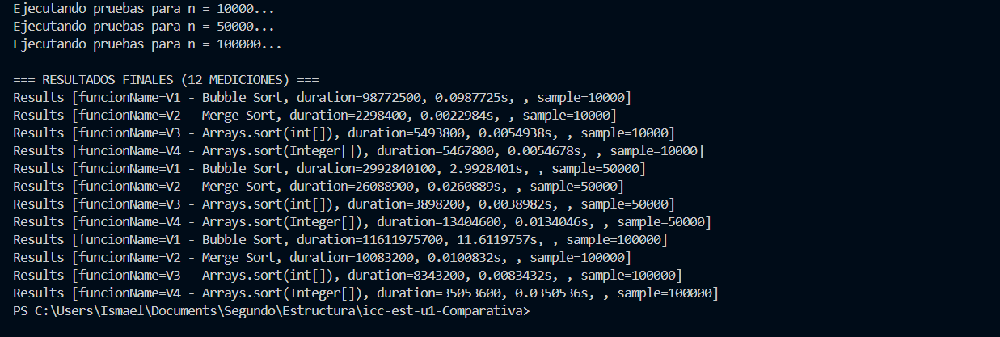

# Evidencias de Ejecución Experimental

## 1. Entorno de Prueba
* **Lenguaje:** Java (JDK)
* **Clase ejecutada:** `src/App.java`
* **Tamaños evaluados:** $n = 10\,000$, $n = 50\,000$ y $n = 100\,000$ enteros aleatorios por muestra.
* **Métrica registrada:** Tiempo real en nanosegundos (`System.nanoTime()`) y su conversión a segundos mediante `Benchmark.medir(...)`.

---

## 2. Captura de Salida en Consola

---

## 3. Verificación de Integridad de las Pruebas
* **Independencia de muestras:** Cada algoritmo ordenó su propia copia (`copia1` a `copia4`) clonada a partir del mismo arreglo aleatorio base para cada tamaño.
* **Total de mediciones:** Se completaron exitosamente las **12 ejecuciones** ($4 \text{ variantes} \times 3 \text{ tamaños}$) sin errores de ejecución ni desbordamiento de memoria.